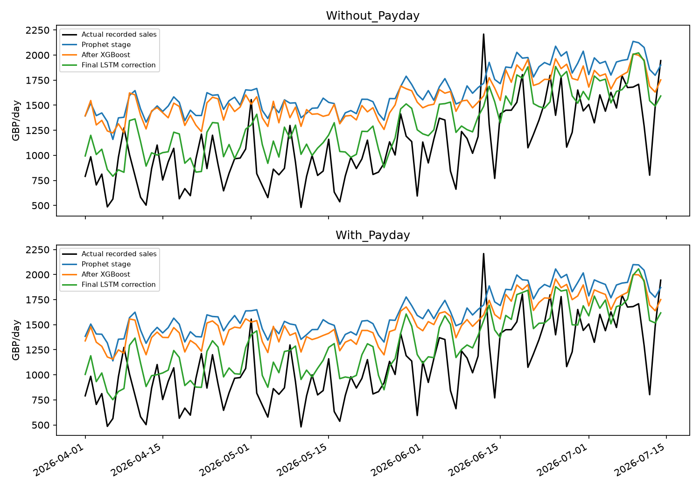
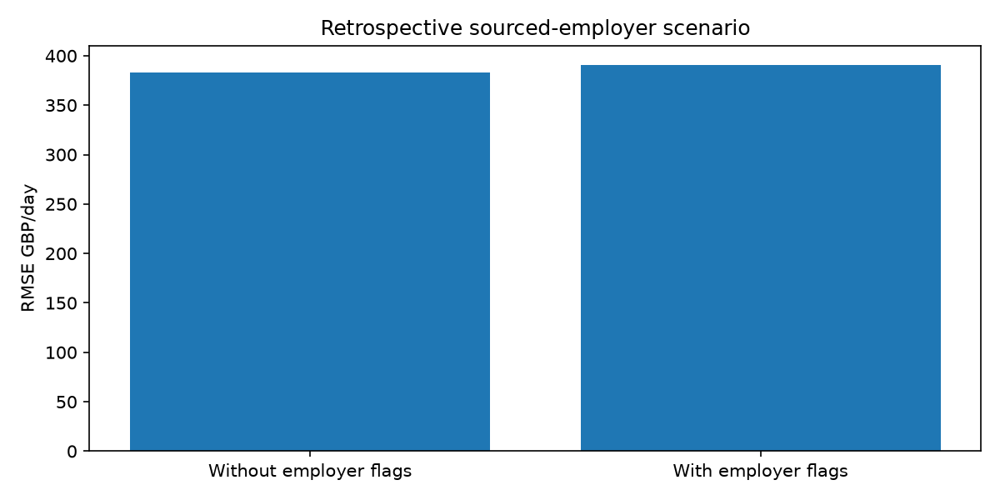

# Retail forecasting methods and evidence update

This update completes the sequential residual hybrid, records online employer-payroll sources, develops the research literature discussion and supplies proposed governance/operational protocols. It is not a dissertation: preparation of the dissertation was explicitly deferred by the researcher. Results below derive from saved executed outputs; customer payroll exposure, permission and realised operational benefits are not invented.

## Executed sequential hybrid

The forecast is Prophet prediction plus XGBoost residual correction plus LSTM remaining-residual correction. The existing convex ensemble is preserved separately. Both cascade variants use the same local-day forecast origin, target, test dates, structural settings and seed. Only the three payroll proxies differ. Source CSVs and the earlier base forecasts are preserved.

To avoid learning later stages from earlier stages' in-sample residuals, Prophet fits the eligible January-June 2025 block (153 days), XGBoost fits July-September (92 days), and LSTM fits October-December (92 days). Earlier stages remain frozen. Historical residuals are available only after their days complete. Stage-specific imputers and residual scaling fit their respective training blocks. January-March 2026 supplies LSTM stopping information, never final-test outcomes.

Prophet changepoint prior scale is 0.05 with weekly seasonality and historical/calendar regressors. XGBoost has 100 depth-2 trees, learning rate 0.03 and minimum child weight 5. The LSTM has eight units, an eight-unit ReLU dense layer, seven prior local-day residual steps, Adam 0.001, batch size 16, at most 40 epochs and patience 5. These manageable settings were fixed before this run. Fewer training samples per stage are a necessary trade-off of the disjoint-block design, so this is not a same-training-budget architecture contest.

The original holdout had already been inspected before the cascade was requested. Its assessment is therefore a later exploratory extension, not a newly blinded confirmatory test. No new test-score search was used to choose its settings. Fresh future data would be needed for prospective confirmation.

| model | n | MAE | RMSE | MAPE positive only |
| --- | --- | --- | --- | --- |
| Sequential_Hybrid_Without_Payday | 105 | 280.711 | 344.967 | 31.876 |
| Sequential_Hybrid_With_Payday | 105 | 265.494 | 328.060 | 29.907 |

The lowest common daily RMSE remains Prophet_With_Payday at GBP 237.650. The cascade does not outperform it. Payday changes must be interpreted from the paired errors, not assumed beneficial from the architecture.

| variant | stage | n | MAE | RMSE |
| --- | --- | --- | --- | --- |
| Without_Payday | Prophet | 105 | 556.419 | 599.930 |
| Without_Payday | Prophet + XGBoost | 105 | 479.046 | 534.957 |
| Without_Payday | Full cascade | 105 | 280.711 | 344.967 |
| With_Payday | Prophet | 105 | 537.748 | 582.170 |
| With_Payday | Prophet + XGBoost | 105 | 450.693 | 501.680 |
| With_Payday | Full cascade | 105 | 265.494 | 328.060 |

## Online payroll evidence and retrospective experiment

Official sources identify employer-specific schedules rather than one national public-sector payday. The NAO manual predates the experiment and states a last-working-day rule; its continuation is assumed. UHL resident-doctor guidance states a 27th-of-month rule with banking-day adjustment, but December is an unspecified exception. Bath lists exact payment dates from November 2025 onwards. URLs, retrieval date, derivation type and unknown coverage are recorded in payroll_sources.json and online_payroll_dates.csv. Payroll submission deadlines are not used as payment dates.

The code leaves UHL December and potentially affected January spillover days unknown, and leaves Bath's uncovered earlier months unknown. Exact Bath dates are audited, not fitted as a fictional full calendar. The exploratory XGBoost pair uses only common NAO/UHL coverage, 306 training days and 105 test days, with identical training rows and shared validation-selected depth. The without variant has calendar/history inputs; the with variant adds the two sourced-employer windows. This differs from the primary 337-day training set, so comparisons across those experiments do not isolate only the feature change.

The UHL page has no established historical publication/effective date. Its historical application is explicitly retrospective and is not certified as information available at every 2025 forecast origin. No source proves these employers are represented among customers. The exact Bath calendar and other employer rules strengthen documentation while retaining these exposure and availability limitations.

| model | train n | n | MAE | RMSE |
| --- | --- | --- | --- | --- |
| Online_Payroll_XGBoost_Without_Payday | 306 | 105 | 288.586 | 383.003 |
| Online_Payroll_XGBoost_With_Payday | 306 | 105 | 292.677 | 390.881 |

| group | n | MAE change | RMSE change |
| --- | --- | --- | --- |
| all | 105 | 4.090 | 7.878 |
| sourced_window | 19 | -6.771 | -3.152 |
| outside_sourced_window | 86 | 6.490 | 9.954 |

| block days | mean absolute loss change | ci 2 5 | ci 97 5 |
| --- | --- | --- | --- |
| 7 | 4.090 | -1.296 | 9.492 |
| 14 | 4.090 | -2.001 | 10.449 |

Employer-calendar error changes are with minus without: negative means improvement. Circular daily block-bootstrap intervals use 1,000 resamples and 7/14-day blocks under an approximate stability assumption. They are exploratory loss-difference intervals, not causal or prospective confirmation.

## Targeted critical literature review

### Literature review for payday aware convenience store forecasting

### Scope and evidence selection

This is a targeted critical narrative review for the implemented project, prepared on 3 November 2026. It is not a systematic review and makes no claim to exhaustive coverage or a formal screening count. Searches combined payday, paycheck receipt, consumption timing, retail forecasting, hybrid forecasting, Prophet, XGBoost, LSTM and time-series validation. Primary research, author-hosted manuscripts, publisher records and the authors' forecasting textbook were prioritised. Some publisher access was restricted: where only an abstract or article preview was available, interpretation is limited to that material. The references below distinguish working papers from published articles.

The review separates three questions: whether spending can respond to income timing; whether a calendar feature predicts this store's recorded revenue; and whether that prediction can support an operational decision. Evidence for one does not automatically answer the others. The research uses store-level sales without linked household income records, so it can investigate predictive associations but cannot identify customers' liquidity or causal payday responses.

### Retail forecasting and the level of aggregation

Fildes, Ma and Kolassa's review (2022, initially available online in 2019) describes retail forecasting across product, store and company aggregation levels and discusses promotional and operational complexity. Its relevance is the connection between the forecast target and the decision it supports. Total-store monetary revenue can describe trading patterns, whereas an inventory decision generally requires product-level quantities. An implication for this project is that shop-level revenue accuracy should not be reported as demonstrated SKU stockout reduction. The review also makes a blanket claim that retail forecasting lacks multivariate or machine-learning work untenable [R1].

The M5 accuracy competition considered retail forecasting with explanatory variables, grouped series and intermittency. Its published design demonstrates that modern retail forecasting already extends beyond isolated univariate models. However, competition design and data availability differ from the present small-store extract: the project lacks a verified stock-availability series and complete trading-hours calendar. Results from a large competition provide methodological context rather than a performance guarantee for one convenience store [R2].

Theodorou et al. (2021) explicitly investigate the representativeness of M5 data by comparison with other retailers. Their analysis supports similarity among the datasets they examine. It does not establish representativeness of every independent convenience store, nor does it show that all supermarket evidence fails to transfer. The present study's defensible contribution is a transparent case study of hourly and daily net revenue with calendar payroll scenarios. A claim that it is the first payday-aware retail forecast would require a broader novelty search [R3].

Aggregation creates a practical trade-off in this project. Daily totals provide a forecast available before a day's transactions, while hourly forecasts expose intraday peaks. A daily sum can still be incomplete if the till extract omits hours. Accordingly, the code predicts recorded net revenue and retains missing observations rather than equating absent records with zero demand. Department comparisons add context, but receipt-level adjustments cannot safely be assigned to specific categories without accounting evidence. Those constraints motivate explicit target and coverage documentation rather than aggressive cleaning.

### Income timing and spending behaviour

Stephens (2002a; subsequently published in 2003) studies US Social Security receipt using expenditure diaries and reports spending responses following scheduled payments. The setting concerns a specific income source and population, so its dates cannot define an English convenience store's payroll calendar. It provides a reason to investigate income timing while highlighting the advantage of observing actual payment dates. Here, a monthly boundary flag is an unverified exposure measure rather than a household-level payment indicator [R4].

Stephens (2002b) uses the United Kingdom's Family Expenditure Survey to study consumption around monthly paycheck receipt. This is geographically closer to the present store than the US benefits setting and supports considering wage timing. Yet it links expenditure to household paycheck receipt, an identification advantage absent from aggregate till data. Its findings justify testing a payroll-related feature; they do not justify selecting a universal British payday or assuming every customer receives monthly salary [R5].

Olafsson and Pagel (2018) analyse individual spending, income and liquidity using financial aggregation data. Their reported payday responses and interpretation of liquid hand-to-mouth behaviour show that a simple claim that payday spending necessarily proves binding liquidity constraints is inadequate. The store dataset contains neither household balances nor verified pay receipts. The present analysis therefore avoids interpreting a sales increase, a SHAP contribution or a model-error difference as evidence that particular customers are financially constrained [R6].

These studies motivate separate calendar hypotheses, not a presumption of improvement. Weekly wages, month-end salaries, employer-specific pay policies and other income sources can coexist. Aggregating them may attenuate a true response, while a Friday flag may absorb ordinary weekend shopping rather than income effects. Calendar and seasonal predictors are therefore kept in both paired models, with payroll variables added only to the payday variant. Overall and payday-window forecast errors are both reported, since a small subgroup gain may coexist with worse accuracy elsewhere.

### Sourced payroll calendars and measurement error

Employer documents offer better provenance than an invented public-sector payday. The National Audit Office HR manual states a last-working-day salary schedule, whereas the Leicester NHS resident-doctor page describes a 27th-of-month rule adjusted for non-banking days and an unspecified December exception. Bath publishes individual payment dates. These are examples for named employers, not observations of this store's customer mix. Published policy, rule-derived historical dates and confirmed bank receipt are different evidence types [P1–P3].

The implementation keeps those types distinct, marks unsupported dates unknown and records URLs and retrieval dates. Applying a currently published NHS rule to 2025–26 is a retrospective scenario because its historical effective/publication date has not been established. Exact Bath dates are retained only for covered months; sparse covered training data prevents presenting it as a complete historical training calendar. No assumption about customer employer membership is needed to calculate a calendar flag, but that missing membership sharply limits its behavioural interpretation.

### Forecasting algorithms and model capacity

Taylor and Letham's forecasting-at-scale approach combines a configurable decomposable model with analyst involvement. This motivates Prophet as an interpretable trend/seasonality benchmark. In this project, its additive structure is supplemented by historical-sales and calendar regressors. Such a benchmark may extrapolate trends differently from tree models, but its original paper does not guarantee superior performance on these data or validate the chosen payday window [R7].

Chen and Guestrin (2016) present XGBoost as a scalable tree-boosting system. Trees offer a practical way to represent nonlinear relationships among lags, weekdays and calendar scenarios. The project's small candidate grids are a computational compromise, not evidence of global optimality. A tree's fit to training-period relationships also does not establish robustness to the rising late-period sales visible in the saved residuals. Comparisons must therefore retain chronology and simple baselines rather than relying on an algorithm's general reputation [R8].

Hochreiter and Schmidhuber (1997) introduce LSTM to address learning dependencies over time. Lim and Zohren (2020) discuss forecasting architectures, forecast horizons and hybrid designs. Their relevance is representational: a sequence must correspond to a defined unit of time and a forecast must use information available at its issue time. The current hourly LSTM uses elapsed clock hours; the daily LSTM uses local calendar days. Neither the architecture's name nor a visually plausible prediction curve verifies that alignment. Small sample size and random training variation remain reasons to report validation design and multiple seeds [R9, R10].

### Hybrid models and residual learning

Zhang (2003) proposes a hybrid ARIMA/neural-network approach motivated by complementary model structure. That supports investigating hybridisation in general; it is not direct validation of the project's particular Prophet/XGBoost/LSTM chain. A weighted ensemble and a residual cascade are different hypotheses. The first averages fitted forecasts. The second makes the forecast equal Prophet's prediction plus an XGBoost correction plus an LSTM correction to the remaining residual [R11].

For the cascade, later learners must not be evaluated on artificially easy residuals created from earlier learners' in-sample fits. The implemented chronological stage allocation fits Prophet first, then trains XGBoost on a later block, then LSTM on another later block. It avoids that source of training contamination at the cost of fewer samples per stage. A poor cascade result would therefore be informative about this constrained implementation, not proof that hybrid forecasting is ineffective generally. The cascade is a later exploratory addition because the historical test outcomes were already inspected; prospective confirmation would need fresh future data.

### Evaluation and explainability

Hyndman and Athanasopoulos describe forecast-origin evaluation and simple benchmarks. For this project, random splitting would allow later sales regimes to inform earlier predictions. The chronological holdouts, pre-test expanding XGBoost folds and shifted historical features instead respect the intended information sequence. Daily and hourly error values have different target scales and must not be ranked together. Percentage errors are restricted to positive daily targets, while MAE and RMSE remain the primary measures. No single metric establishes operational value [R12].

Lundberg and Lee (2017) describe additive feature attribution through SHAP. In this study, Tree SHAP explains XGBoost predictions and is numerically checked for additivity. A large contribution shows influence on a fitted prediction, not a customer's reason for shopping. Correlated monthly, weekday and employer-calendar flags can share explanatory attribution. The predictive question is instead addressed by paired forecast errors; causal explanations would require an appropriate design and income-exposure information that the till data do not contain [R13].

Hourly and daily forecast errors are temporally structured, and payroll windows cluster. The project's daily circular block bootstrap is consequently treated as sensitivity analysis under approximate stability, with two block lengths. Drift and a short test period limit the interpretation of intervals. More model complexity and additional calendar searches after inspecting test results create further selection concerns. The reporting explicitly distinguishes the earlier fixed comparison from the later exploratory employer-calendar and cascade analyses rather than relabelling all results as a new untouched test.

### Implications for the research questions

The literature supports testing whether calendar payroll information adds predictive value while preserving the possibility of no improvement. The proposed contribution is evidence for one store under explicit hourly and upcoming-day forecast tasks, not a universal claim about payday behaviour. The completed code links this question to an audited target, matched within-family variants, conventional baselines, aligned timestamps and saved full-precision predictions. Published employer calendars strengthen source documentation, but do not resolve unknown customer exposure.

Operational implications require a separate evidential step. A high-revenue-hour classifier can be checked against recorded sales, but translating that signal into staffing needs requires service-time and staffing observations. Product replenishment requires stock, lead-time and cost information. A future prospective pilot should freeze a policy before collecting outcomes, compare like trading periods and record implementation costs. Until such data exist, the research can report forecasting utility scenarios without claiming proven stockout, staffing or profitability gains.

### References

R1. Fildes, R., Ma, S. and Kolassa, S. (2022). Retail forecasting: Research and practice. International Journal of Forecasting, 38(4), 1283–1318. https://doi.org/10.1016/j.ijforecast.2019.06.004 . Publisher abstract/preview consulted.

R2. Makridakis, S., Spiliotis, E. and Assimakopoulos, V. M5 accuracy competition: Results, findings and conclusions. Author preprint (2020), published version 2022. https://statmodeling.stat.columbia.edu/wp-content/uploads/2021/10/M5_accuracy_competition.pdf . Author preprint abstract consulted.

R3. Theodorou, E. et al. (2021). Exploring the representativeness of the M5 competition data. https://arxiv.org/abs/2103.02941 . Author abstract consulted.

R4. Stephens, M. Jr. (2002a). '3rd of tha Month': Do Social Security Recipients Smooth Consumption Between Checks? NBER Working Paper 9135. https://www.nber.org/papers/w9135 . NBER abstract and published-version metadata consulted.

R5. Stephens, M. Jr. (2002b). Paycheck Receipt and the Timing of Consumption. NBER Working Paper 9356. https://www.nber.org/papers/w9356 . NBER abstract consulted.

R6. Olafsson, A. and Pagel, M. (2018). The Liquid Hand-to-Mouth: Evidence from Personal Finance Management Software. Review of Financial Studies, 31, 4398–4446. https://business.columbia.edu/faculty/research/liquid-hand-mouth-evidence-personal-finance-management-software . Author institution abstract consulted.

R7. Taylor, S.J. and Letham, B. (2017). Forecasting at scale. PeerJ Preprints 3190v2; subsequently published in 2018. https://peerj.com/preprints/3190.pdf . Author preprint record consulted.

R8. Chen, T. and Guestrin, C. (2016). XGBoost: A Scalable Tree Boosting System. https://arxiv.org/abs/1603.02754 . Author abstract consulted.

R9. Hochreiter, S. and Schmidhuber, J. (1997). Long Short-Term Memory. Neural Computation, 9(8), 1735–1780. https://doi.org/10.1162/neco.1997.9.8.1735 . Publisher record/abstract consulted.

R10. Lim, B. and Zohren, S. (2020 preprint). Time Series Forecasting With Deep Learning: A Survey. https://arxiv.org/abs/2004.13408 . Author abstract consulted.

R11. Zhang, G.P. (2003). Time series forecasting using a hybrid ARIMA and neural network model. Neurocomputing, 50, 159–175. https://doi.org/10.1016/S0925-2312(01)00702-0 . Publisher abstract/preview consulted.

R12. Hyndman, R.J. and Athanasopoulos, G. Forecasting: Principles and Practice, third edition, forecaster's toolbox. https://otexts.com/fpp3/toolbox.html . Authors' textbook consulted.

R13. Lundberg, S.M. and Lee, S.-I. (2017). A Unified Approach to Interpreting Model Predictions. https://arxiv.org/abs/1705.07874 . Author abstract consulted.

P1. National Audit Office (2024). HR manual, pay chapter. https://www.nao.org.uk/wp-content/uploads/2024/06/foi-1710-hr-manual.pdf . Salary schedule inspected.

P2. University Hospitals of Leicester NHS Trust. Resident doctor useful information. https://www.uhleicester.nhs.uk/careers/planning/resident-doctors-induction/resident-doctor-useful-information/ . Pay policy inspected.

P3. University of Bath. Payroll deadlines, 2025–27. https://www.bath.ac.uk/corporate-information/payroll-deadlines/ . Payment-date column inspected.

Sources checked 3 November 2026. Store-specific results come from executed project outputs, not these publications.

## Data management and disclosure review

A local monthly department-coded review candidate contains 371 cells, with 48 cells suppressed below ten distinct receipts. Values are rounded to whole pounds. Direct customer/receipt/product/payment identifiers are excluded. This threshold is not a proof of anonymity, and totals remain commercially sensitive. No file was published and release_authorised remains false.

### Retail forecasting data management protocol

Status: proposed protocol for researcher, store owner and university review. This document is not a signed permission, ethics approval or certification of legal compliance. No access permissions, encryption settings or retention actions have been silently changed.

### Data flow and purpose

The original CSVs are preserved locally. Transaction records include customer/receipt identifiers and detailed purchase timing, so they are treated as potentially identifiable and commercially sensitive. Preparation creates hourly and daily aggregates, calendar features and historical sales inputs. Models do not use customer IDs, receipt IDs, barcodes or payment-type identifiers as predictors. Prediction CSVs and trained models remain commercially sensitive even when those identifiers are absent.

The research purpose is to evaluate aggregate revenue forecasting and calendar payroll scenarios. Individual customer profiling, linking transactions to personal income and identifying employers of particular shoppers are outside this purpose. Public employer payroll pages are downloaded or transcribed independently of transaction records; shop data are not sent to these employers or uploaded to search services.

### Responsibilities requiring confirmation

The researcher and supervisor should identify the responsible controller, document the appropriate lawful basis with the institution, record store permission and determine whether an ethics application or amendment is required. Store permission, an ethics reference and lawful basis are separate matters. Blank fields in evidence_status.json mean unconfirmed, not approved. Signatures and approval dates must be supplied by the responsible people rather than generated by code.

### Proposed storage and access procedure

Use institution-approved encrypted storage, restrict raw access to named authorised people and maintain a separately approved backup. Record the actual storage location and approved access list in the institutional record. Do not place raw CSVs, credentials, source identifiers or detailed prediction exports in public repositories. Verify device encryption, account access and backup arrangements with the relevant owner; the project has not audited those controls.

Keep source originals read-only where practical after preservation. Maintain hashes for integrity, but do not describe hashes as encryption or anonymisation. Store processing logs separately from external permission documents where those contain names or contact details. Avoid unapproved cloud transfer. Check repository history and backups as well as current directories before any authorised publication.

### Minimisation and disclosure review

Prefer derived aggregate data to transaction-level exports for sharing. The privacy_export.py script produces a monthly, department-coded review candidate, with small receipt-count cells suppressed and monetary values rounded. It does not include raw receipt/customer IDs, product names, barcodes or payment information. Its suppression threshold is a heuristic for review, not proof of anonymity. Department coding, aggregation and rounding do not eliminate linkage risks or business confidentiality concerns.

Before release, assess the intended audience, other information they may possess, unusual trading events and whether timestamps or small categories could identify people. Obtain store publication permission and institutional review as appropriate. The generated candidate remains local and is not automatically published. Trained models and detailed forecasts also require review; deleting a customer column alone is insufficient.

### Retention and incident procedure

Agree a justified retention period and review date with the university and store. No arbitrary expiry date is imposed by this draft. Record the policy reference and approved review date, then include original data, derived outputs, archives, model checkpoints, notebooks and backups in the eventual authorised return/deletion decision. Do not automatically delete research originals merely because a template field is blank.

If data are lost, exposed or accessed without authority, stop further sharing, preserve relevant logs and follow institutional incident-reporting procedures promptly. The institution determines any further notifications. The script cannot establish whether an incident is legally reportable.

### Guidance and review basis

ICO guidance explains that pseudonymised information can remain personal data and that removing obvious identifiers does not by itself establish effective anonymisation. Its storage-limitation guidance requires a justified approach to retention rather than a universal fixed period. This draft uses those principles as a review basis; it does not select the researcher's lawful basis.

ICO, introduction to anonymisation: https://ico.org.uk/for-organisations/uk-gdpr-guidance-and-resources/data-sharing/anonymisation/introduction-to-anonymisation/

ICO, pseudonymisation: https://ico.org.uk/for-organisations/uk-gdpr-guidance-and-resources/data-sharing/anonymisation/pseudonymisation/

ICO, storage limitation: https://cy.ico.org.uk/for-organisations/uk-gdpr-guidance-and-resources/data-protection-principles/a-guide-to-the-data-protection-principles/storage-limitation/

Guidance checked 3 November 2026. Institution-specific policy and final approval remain to be supplied.

## Operational evaluation readiness

### Prospective operational validation plan

Status: ready-to-adapt study protocol, not an executed business-impact evaluation. Revenue peak precision/recall and over/underforecast totals have already been calculated from recorded sales; actual staffing savings, inventory improvements and profit changes have not.

### Define the decision before collecting outcomes

Choose staffing or a small set of inventory items as the primary decision. Freeze the forecast model, origin, thresholds, comparator policy and analysis before the pilot. Use future trading periods that were not inspected during model development. Record closures, extraction failures, promotions, price changes and policy overrides rather than treating all changes as model effects.

### Staffing pilot

Collect timestamp, receipt count, scheduled staff-hours, actual staff-hours, service-time or queue measurements, wages and opening status. Avoid employee names and customer identifiers in the research table. Specify a capacity rule using measured transaction/service workload rather than assuming each pound of revenue requires equal labour. Compare the forecast-assisted rule with the store's existing practice using a practicable crossover or staggered design agreed with the store. Measure service outcomes and labour costs together; lower labour cost with materially worse queues is not automatically success.

### Inventory pilot

For selected SKUs collect date, pseudonymous product code, opening stock, replenishments, recorded units sold, closing stock, verified stockout periods, selling price, acquisition cost, spoilage, lead time and order decisions. Revenue alone cannot recover lost demand while stock is unavailable. Predefine service-level and holding/shortage cost measures and account for stockout censoring. Department net-revenue models cannot be directly interpreted as SKU reorder quantities without a separate quantity forecast and inventory policy.

### Evaluation

Record both planned and actually implemented decisions. Report missingness and adherence. Compare matched trading periods and account for temporal dependence and changes in promotions, holidays and demand. Treat financial savings as model-associated unless the design supports stronger attribution. Include implementation cost and adverse outcomes. Use a justified sample-size or precision plan based on pilot variability; do not invent a number of weeks that guarantees significance.

CSV headers in governance/templates define candidate fields. They are intentionally empty. Neither file is evidence that a pilot has occurred. After real observations are available, agree the final policy and analysis with the supervisor before calculating business-impact claims.

## Verification and remaining evidence

Verified code checks include disjoint cascade training blocks, out-of-earlier-stage-training residual targets, training-only scaler inversion, future-residual sequence invariance, additive reconstruction of saved forecasts, actual-sales agreement, explicit payroll unknown coverage and identifier/suppression checks for the review candidate. The final status files distinguish technical completion from missing institutional and operational evidence.

Remaining items are evidence-dependent: store permission, institutional ethics/lawful-basis decisions, verified storage/access/retention arrangements, actual customer income exposure, complete recording/opening hours, and a prospective operational pilot. Empty templates are not pilot results. Dissertation work is deferred at the researcher's request. Online employer schedules do not remove those limits.

Run python src/sequential_hybrid_model.py, python src/online_payroll_analysis.py, python src/privacy_export.py, python src/next_day_comparison.py and python src/research_completion.py, using the project environment. The comparison and completion report read saved predictions. Full run_all.py and run_extensions.py include the new stages.
